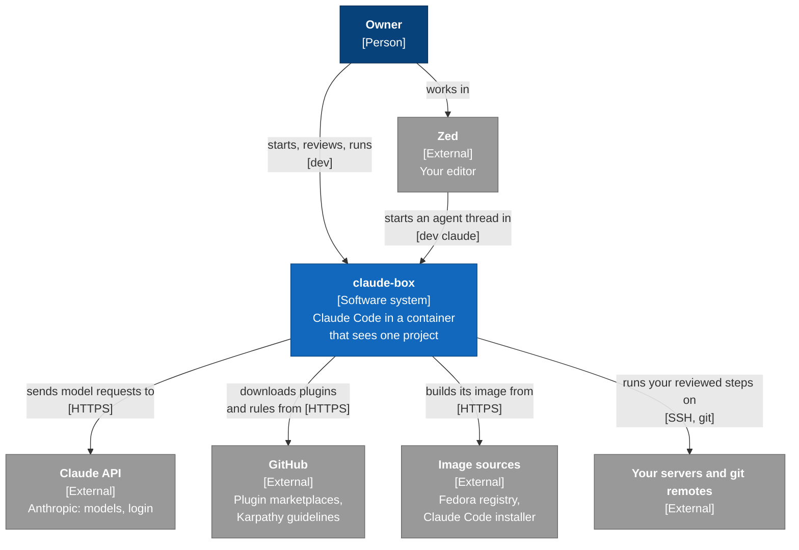

# Level 1 — System context — claude-box

> **Diagram type**: System context
> **Scope**: claude-box, the person who uses it, and the systems around it.

## Diagram

## Elements

| Element | Type | Description |
|---|---|---|
| Owner | Person | Starts Claude in a project, reviews its branches and `out/actions.txt`, merges, and runs `dev run` |
| claude-box | Software system | This repo: [containers](02-container.md) |
| Zed | External | Your editor: its agent thread starts `dev claude`, its terminal runs `dev run`, its Markdown preview shows drafts and docs. It has no Claude agent of its own |
| Claude API | External | Anthropic's API; the box logs in once (`dev init`) and sends every model request there |
| GitHub | External | The plugin marketplaces and pinned rules files your `plugin` and `rules` lines name ([core/defaults.dev](../../../core/defaults.dev)), fetched when a line first appears |
| Image sources | External | Fedora's registry (`fedora:44`) and Claude Code's installer (`claude.ai/install.sh`), at image build |
| Your servers and git remotes | External | Reached only by `dev run` on your laptop, as you: `root`/`host` steps over SSH, pushes as `local` steps. The box itself holds no credentials for them |
