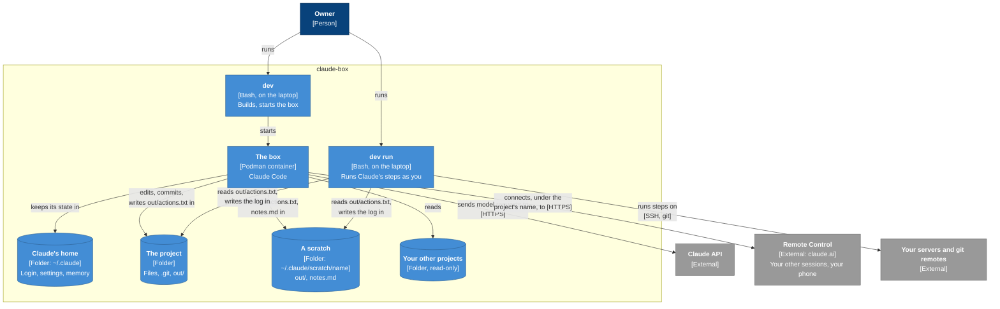

# Level 2 — Container — claude-box

> **Diagram type**: Container
> **Scope**: claude-box's parts and the data they use. "Container" in
> the C4 sense: a separately running program or data store.

## Diagram

## Elements

| Element | Type | Technology | Responsibility |
|---|---|---|---|
| dev | Container | [dev](../../../dev) (Bash), on your `PATH` through `./dev install`; its parts in [core/lib/](../../../core/lib/) | The one command: reads your config and, after your yes to a change, builds it as your layer; builds the images, starts the project's box or joins the running one (a project is a repo's top folder or a folder in `~/Projects`, never `$HOME` or `/`; `dev claude` with Remote Control under the folder's name); outside a project, `dev claude` starts a scratch session, and `dev claude --scratch`, `dev scratch` and `dev run --scratch` come back to, list, delete and run one; installs what the project's `.dev` lists after asking, creates projects, hands `dev run` to run-actions |
| dev run | Container | [run-actions](../../../core/bin/run-actions) (Bash) | Runs `out/actions.txt` as you: [how](README.md#dev-run) |
| The box | Container | The `localhost/claude-box` image ([Containerfile](../../../core/Containerfile)): Claude Code (its version set by `dev build`), git, ripgrep, `ps`, ShellCheck, `diff`, `patch`; or, for a project whose `.dev` lists packages, its own image built on it ([how](03-deployment.md#the-image)); [stage-seed](../../../core/bin/stage-seed) stages marketplace plugins into a seed, in a throwaway box; the box's own plugin, [box-workflow](README.md#the-boxs-own-plugin), and [run-actions](../../../core/bin/run-actions) for its read-only checks | Runs Claude Code: one box per project or scratch, shared by its `dev claude` and `dev shell` sessions and gone after the last; every other `dev` command starts a fresh one (`--rm`); [its settings and mounts](03-deployment.md#the-box) |
| Your config | Container (data store) | `~/.claude/.dev`; the defaults in [core/defaults.dev](../../../core/defaults.dev) | Your git identity, what you bring in (`plugin`: plugins, skills, marketplace plugins; `rules`: rules files), packages, projects folder, caps, Remote Control, and groups (`group` folders, `remote` members, `autotake group`); the copy you approved last, with every file it names, is in `~/.local/state/claude-box/approved/`, whose rules boxes mount read-only, nothing else of it; your yeses to `.dev` group lines beside it, in `group-yes` ([mounts](03-deployment.md#mounts)) |
| Plugins | Container (data store) | [plugins/](../../../plugins/) in the clone, tracked | Optional Claude Code plugins, each with an optional `rules/` and `starter/`; reach a box only when your config names them ([architecture](README.md#plugins)) |
| Claude's home | Container (data store) | Your `~/.claude`, at `/home/claude/.claude` | Claude's login, settings, plugins' state, memory, history, global `~/.claude/CLAUDE.md` and `.claude.json`; you open and edit it like any of your files; neither `dev build`, `dev reset` nor `dev uninstall` touches it |
| The project | Container (data store) | The folder you start `dev` in, with its `.git` | What Claude works on; `.dev` lists what its box needs (dnf, npm and pip packages, marketplace plugins, ports to publish, the group it joins after your yes); `out/` (in `.gitignore`) holds the `dev run` files, the handoffs, drafts waiting on you, and `done/`: used drafts, deleted by box-workflow after 14 days ([rule](../../../core/rules/CLAUDE.md)); `actions.done` and the handoffs aren't trimmed ([accepted risk](README.md#accepted-risks)) |
| A scratch | Container (data store) | `~/.claude/scratch/<name>` (a random adjective-noun), at `/work/scratch-<name>` in its box | A session outside any project: `out/` as in a project (no `.gitignore`, no handoffs) and `notes.md`, whose first line names the job for `dev scratch`; no repo, no `.dev`. Its conversations and memory are in `~/.claude/projects/-work-scratch-<name>/`; `dev scratch --rm` deletes both after asking |
| Your other projects | Container (data store) | `~/Projects` (or `DEV_PROJECTS`) | Read by Claude; a change to one comes as a prompt for that project's own Claude session, sent to it when it runs |
| Remote Control | External | claude.ai, with your login | Carries messages between your sessions (SendMessage) and lets you drive a box from claude.ai or your phone; [accepted risk](README.md#accepted-risks) |
