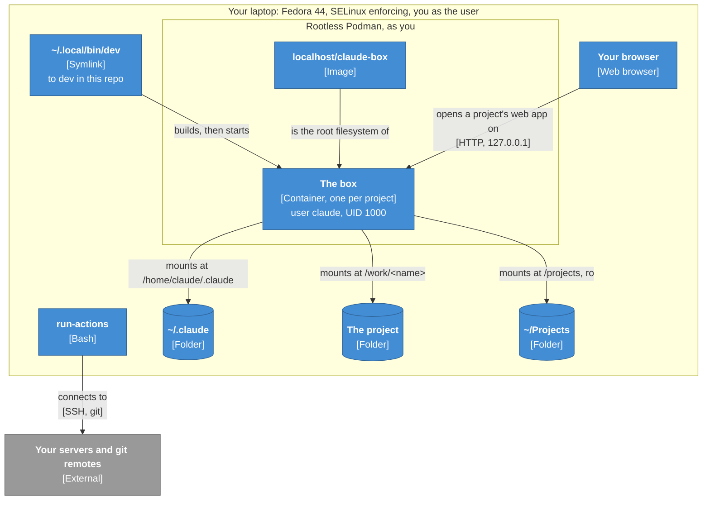

# Deployment — claude-box

> **Diagram type**: Deployment
> **Scope**: where claude-box runs on your laptop, and what the box has
> mounted.

## Diagram

## The box

How `dev` starts it (`box()` and `run_box()` in [dev](../../../dev)):

| Setting | Value | Why |
|---|---|---|
| Name and label | `claude-box-<name>` (the project image's name), label `claude-box.project=<project path>` (its real path: through a symlink, the folder itself), for `dev claude` and `dev shell` | Their sessions join it with `podman exec`; a box of the same name from another folder is refused, pointing at `--new` |
| Lifetime | `--rm`, `--init`, started detached (`-d`) with a watcher as its command | The watcher waits up to 60 s for the first session, then ends when no other process is left, and `--rm` removes the box. One `dev` at a time checks and starts it, under a lock per box (`flock` on `$XDG_RUNTIME_DIR/<box name>.lock`; without `XDG_RUNTIME_DIR`, `dev` refuses): a second one says which `dev` it's waiting for (the holder writes its command, process and start time into the file), waits with no limit, then joins. A box left stopped (e.g. by a shutdown) is removed and replaced, never joined; one that ends just as a `dev` joins it is replaced once; `dev reset` removes them all. `--new`, `dev init` and the plugin installs start a one-off box instead; only the mounts persist |
| User | `--userns=keep-id:uid=1000,gid=1000`: user `claude` (UID 1000) in the box is you on the laptop | Files it writes in the project belong to you |
| Privileges | `--cap-drop=all`, `--security-opt=no-new-privileges` | Nothing to escalate to |
| Memory and CPU | Uncapped; your config's `memory` and `cpus` (or `DEV_MEMORY` and `DEV_CPUS`, which win) become `--memory` and `--cpus` (ceilings, nothing reserved; each box gets its own). Processes stay at Podman's default of 2048. | A runaway build or test stops in the box, not on your laptop; off by default, since the right numbers depend on the machine |
| Hostname | `claude-box` | |
| Ports | Each `port <n>` in the project's `.dev`, for `dev claude` and `dev shell` only: `-p 127.0.0.1:<n>:<n>`. Before the start, `dev` binds `127.0.0.1:<n>` on the laptop once to test it; if that fails (e.g. the project's box has it, and this is a `--new` one), the box starts without that port and says so. Sessions that join the project's box share its ports. Two boxes started at the same instant can still race for it. Not in the image or its label. | `http://localhost:<n>` on the laptop reaches an app listening on `0.0.0.0:<n>` in the box; nothing else on the network can, though other users on the laptop can, as with any localhost port |
| Environment | `CLAUDE_CONFIG_DIR=/home/claude/.claude`, `DISABLE_AUTOUPDATER=1`, `CLAUDE_CODE_PLUGIN_DIRS` naming the box's own plugin (image), then your plugin folders (your layer), separated by `:` | `.claude.json` lives in `~/.claude` too; only `dev build` changes Claude Code |
| Working directory | `/work/<name>` (`-w`) | Claude Code keeps memory and sessions per path, so each project has its own |
| Home | The rest of `/home/claude` comes from the image | Kept while the box runs, gone with it: caches and shell history don't carry over to the next box |

## Mounts

Everything of yours the box sees:

| In the box | From the laptop | Access | Options |
|---|---|---|---|
| `/work/<name>` | The project folder you ran `dev` in; `<name>` is the folder's name | read-write | `:z` |
| `/work/<name>/.git` | Its `.git` | read-write, so Claude can commit | `:z` |
| `/projects` | `~/Projects` (`DEV_PROJECTS`), if it exists | read-only | `ro,z` |
| `/home/claude/.claude` | `~/.claude` (`dev` creates it if missing) | read-write | `:z` |
| `/home/claude/.claude/plugins` | Nothing: an anonymous volume, removed with the box, so only the image's plugins load; it starts with the image's [registration](#plugins) | read-write | `U` |
| `/home/claude/.claude/plugins/data`, `/home/claude/.claude/plugins/store` | `~/.claude/plugins/data` and `~/.claude/plugins/store` (`dev` creates them if missing): plugins' state | read-write | `:z` |
| `/home/claude/.claude/rules/files/<file>` | Each rules file your `rules` lines name, and the project's, in their approved copies | read-only | `ro,z` |
| `/home/claude/.claude/rules/<plugin>/` | The `rules/` of each plugin your `plugin` lines name, and the project's, in their approved copies | read-only | `ro,z` |
| `/etc/claude-box/groups` | `~/.local/state/claude-box/groups/<name>-<hash of the project's path>`, one per project, written at each box start when the project is in a group: the group's name, each other member's name and path under `/projects` (or `remote`), and `autotake group` when your config has it | read-only | `ro,z` |
| `/etc/claude-box/host` | `~/.local/state/claude-box/host`, written at each box start: your laptop's OS (`os`), your shell (`shell`), and which of a fixed list of commands it `has` and `lacks`, for the `dev-run` skill | read-only | `ro,z` |

`dev` creates each rules mount point in your `~/.claude/rules/` first,
so it's yours: one Podman created would belong to a user of its
namespace, which you couldn't remove. They stay there, empty. A link
on the way is refused (any box can write `~/.claude`). When you approve
a change, the copy before moves to `~/.local/state/claude-box/approved-old/`
for 30 days, so boxes still running keep their rules. Your yes to a
project's `.dev` group line (asked with Enter as no, only for a project
in your projects folder) is kept beside it, in
`~/.local/state/claude-box/group-yes` (`<group> <project path>`), out of
the box's reach.

`dev init` starts the box with `~/.claude` only.

A scratch session's box (`claude-box-scratch-<name>`, label
`claude-box.project=<its folder>`) has its folder instead of a
project's, and no `.git`; it runs on the base image, with no plugins
from a `.dev` and no ports:

| In the box | From the laptop | Access | Options |
|---|---|---|---|
| `/work/scratch-<name>` | `~/.claude/scratch/<name>` | read-write | `:z` |
| `/projects` | `~/Projects` (`DEV_PROJECTS`), if it exists | read-only | `ro,z` |
| `/home/claude/.claude` | `~/.claude` | read-write | `:z` |
| `/home/claude/.claude/plugins/...` | As above: the box's own, with your `data` and `store` | read-write | |
| `/home/claude/.claude/rules/...` | The global rules above, no project rules | read-only | `ro,z` |
| `/etc/claude-box/host` | The laptop's facts, as above | read-only | `ro,z` |

**SELinux:** the folders get the shared container label (`:z`); a
private label per project (`:Z`) would hide it from the other boxes'
`/projects`. `~/.claude` gets the same label. The first start relabels
all of `~/Projects` once (slow with big dependency folders); your own
access is unaffected.

## The image

Built by `dev build` (`podman build --pull=newer`) from the
[Containerfile](../../../core/Containerfile), with `core/` taken from the
clone's `main` (`git archive main core`), never from the working tree,
and labelled with a hash of git's tree ids of the parts of `core/` it
holds (`Containerfile`, `managed-settings.json`, `rules/`, `bin/`,
`plugin/`; not `dev`'s own `lib/`, `defaults.dev` or the README) and
with `main`'s commit. At every new box, `dev` compares that hash with
`main`'s: a difference is shown as the commits and files since the
image's commit, and rebuilt after your yes; no, or no
terminal, starts on the old image and says so. A rebuild, of this image or a
project's, removes the image it replaced by its ID, and earlier
leftovers of its own (untagged, label `claude-box.image`) once no box
uses them; Podman keeps an image while a box uses it. Nothing else of
yours is removed:

| Part | Where | Owner |
|---|---|---|
| Fedora 44 with git, ripgrep, findutils, procps-ng (`ps`), ShellCheck, diffutils (`diff`, `cmp`), patch, python3 | the image | root |
| The rules: the files of [core/rules/](../../../core/rules/), `CLAUDE.md` importing the others; [managed-settings.json](../../../core/managed-settings.json): auto mode's description of the box, telemetry off, the commit hook, the `ask` rules | `/etc/claude-code/`, mode 644 | root |
| The commit hook, [no-commit-on-main](../../../core/bin/no-commit-on-main) | `/usr/local/bin/` | root |
| [stage-seed](../../../core/bin/stage-seed) | `/usr/local/bin/` | root |
| The box's own plugin, [core/plugin/box-workflow](../../../core/plugin/box-workflow/) | `/usr/local/share/claude-box/plugins/box-workflow` | root |
| [run-actions](../../../core/bin/run-actions), for the plugin's `--check` and `--status` | `/usr/local/bin/` | root |
| Claude Code, from its installer, auto-updater off | `/usr/local/bin/claude` | root |
| Claude's git identity, `Claude <claude@claude-box.invalid>` (`.invalid` is never delivered) | `/etc/gitconfig` | root |

### Your layer

When your `~/.claude/.dev` has `identity`, `dnf`, `npm`, `pip` or
`plugin` lines, every box runs on `localhost/claude-box.user`
(a name no project's image can get), built `FROM localhost/claude-box`;
project images and scratch boxes build on it:

| Part | How |
|---|---|
| Your identity | `git config --system` in `/etc/gitconfig` |
| Your packages | `dnf -y install` (plus `npm`, `python3-pip` when needed), `npm install -g`, `pip install`; names single-quoted |
| Your plugins | `/usr/local/share/claude-box/plugins/<name>` (never `box-workflow` or `files`), appended to `CLAUDE_CODE_PLUGIN_DIRS`; a plugin's `starter/` comes with it. One named by name comes from the clone's `main` (a copy of `main:plugins` under `~/.local/state/claude-box/main/`), never from a checked-out branch |
| Your marketplace plugins | Your approved seed at `/usr/local/share/claude-box/seed/` (`CLAUDE_CODE_PLUGIN_SEED_DIR`), switched on in `/etc/claude-code/managed-settings.d/claude-box-plugins.json` ([plugins](#plugins)) |
| Labels | `claude-box.config` (the hash of the approved config it was built from, its seed included), `claude-box.base` (the base's ID), `claude-box.image` |
| Approval | A change to `~/.claude/.dev` or a file it names is shown as a diff against the copy you approved last (`~/.local/state/claude-box/approved/`: `.dev`, and each source under `plugins/`, `home/` or `urls/`; a URL's file is fetched once and kept there, its pin) and built after your yes; no, or no terminal: the approved one. A copy `dev` can't read (e.g. with kinds from before a change of schema) counts as none: it shows your whole config and asks, and without a terminal refuses to start. A new base rebuilds it from that copy without asking |

### A project's image

When the project's `.dev` lists dnf, npm or pip packages, its box runs on
`localhost/claude-box-<name>` instead, built on your layer or the base (`<name>`: the folder's name,
lower-cased, other characters turned into `-`). `dev claude` and
`dev shell` build it from a generated Containerfile:

| Part | How |
|---|---|
| Base | `FROM localhost/claude-box` |
| Packages | as root: `dnf -y install` (plus `npm`, `python3-pip` when needed), `npm install -g`, `pip install`; each name single-quoted, from a restricted character set |
| Label `claude-box.packages` | the sorted packages, `kind:name`: a change is shown and built only after you confirm at a terminal (`[Y/n]`, Enter is yes; without a terminal, no) |
| Label `claude-box.base` | the base's image ID: after `dev build`, rebuilt without asking |
| Its plugins | by name or folder under `/usr/local/share/claude-box/plugins/`; from a marketplace, its approved seed at `/usr/local/share/claude-box/seed-project/`, named first in `CLAUDE_CODE_PLUGIN_SEED_DIR` (then yours), switched on in `claude-box-project-plugins.json` beside yours; the label gains `src:<hash>` of them |

## Plugins

A marketplace plugin lands in a Claude Code seed
([seed directories](https://code.claude.com/docs/en/plugins/org.md#seed-containers-and-ci)),
one per level, built into that level's image:

| Step | How |
|---|---|
| Staging | `podman run` of the base image with only the staging folder mounted, `CLAUDE_CODE_PLUGIN_CACHE_DIR` set to it and a throwaway `CLAUDE_CONFIG_DIR`; [stage-seed](../../../core/bin/stage-seed) runs `claude plugin marketplace add` and `claude plugin install` for every line of that level and the dependencies of its folder plugins |
| Approval | the seed is part of the snapshot: its version and commit per plugin are shown with the `.dev` diff, in one question; after your yes it's kept as `seed/` in the approved copy. A plugin restaged with the same files and version is taken without asking |
| The check | at every `dev claude`, `git ls-remote` (over HTTPS, 10 s each) on each marketplace repo and each plugin's own repo its `marketplace.json` entry names, against the heads recorded at staging (`seed/claude-box-heads`); nothing moved: no box. Offline, or without a terminal: the approved seed, said in one line. git never prompts, and a plugin's own repo is checked only over HTTPS; a staging box that hangs is stopped after 10 minutes |
| In the image | copied in, owned by root; Claude Code never writes to a seed and turns its auto-update off. `enabledPlugins` in a managed-settings drop-in switches each plugin on, so no session can switch it off |
| Registration | the image's `/home/claude/.claude/plugins/known_marketplaces.json` names the seeds' marketplaces (a project's image: its own, then yours; the first wins), each at its folder in the image's seed, auto-update off; each box's new plugins volume starts with it, so the first session finds them registered, needs no `/reload-plugins`, and may write the file. A name that isn't `[A-Za-z0-9_.-]+` is left out |
| Clearing what's left | whenever `dev` starts a box (`dev claude`, `dev shell`), `dev` itself (no box) lists what earlier claude-box versions left in `~/.claude/plugins` for the plugins of your approved seed, or the project's: their install records at any scope, the cache copies only those used, the marketplaces left with no record or recorded under the image's seeds, their `enabledPlugins` in `settings.json`; it removes exactly those after your yes, and nothing if the list changed or a link sits on the way |

A box's `~/.claude/plugins` is its own, so it finds no plugin but the
image's; a plugin's state stays in your `~/.claude/plugins/data/` and
`store/` (a [known limit](README.md#known-limits)).
